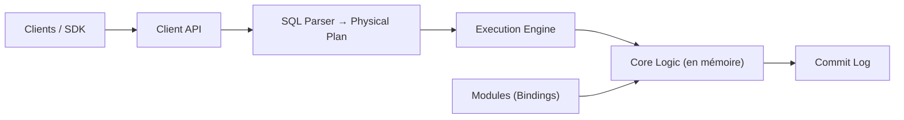

# clockworklabs/SpacetimeDB

> Base relationnelle qui héberge la logique applicative et synchronise les clients en temps réel.

## Le problème
Un backend classique empile serveur web, base, cache et pub/sub pour garder les clients à jour.

## Ce que ça fait vraiment
Tu écris un module (Rust, C#, TypeScript ou C++) avec tables et reducers ; il s'exécute dans la base et les clients s'y connectent directement et s'abonnent aux tables. État en mémoire, journal de commit sur disque (durabilité, lectures confirmées par défaut depuis la 2.0). Le backend du MMORPG BitCraft tourne dessus. Optimisé pour des charges transactionnelles, pas analytiques.

## Comment c'est branché


## Essayer
```bash
curl -sSf https://install.spacetimedb.com | sh
spacetime login
spacetime dev --template chat-react-ts
# ou en local
docker run --rm --pull always -p 3000:3000 clockworklabs/spacetime start
```

## Coût et pièges
`spacetime dev` publie sur Maincloud (compte GitHub, tarification à consulter). Licence présente mais non identifiée par GitHub. 942 issues ouvertes.

## Ce que ce n'est pas
Pas fait pour le batch ni l'analytique. Les modules s'exécutent dans la base : permissions à écrire soigneusement.

## Alternatives
Aucune alternative nommée dans le README.

## Pour toi
Curiosité pour des apps temps réel ; peu de place dans un pipeline data classique, et la licence est à lire avant tout usage.

