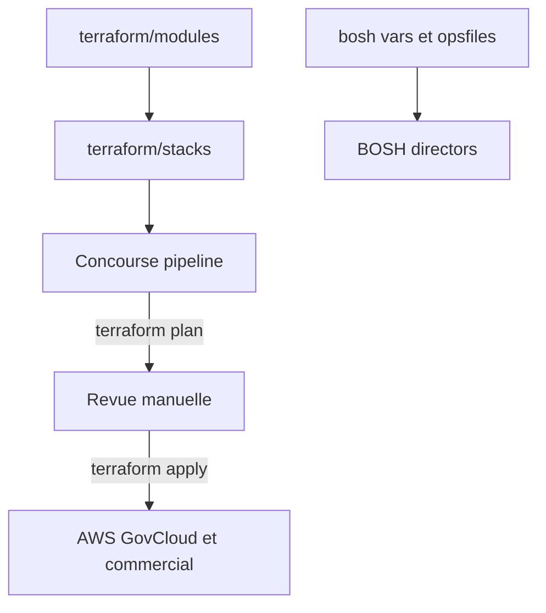

# cloud-gov/terraform-provision

> Terraform and BOSH configuration that bootstraps the cloud.gov platform infrastructure.

## The problem
A multi-account, multi-region platform requires infrastructure that is described and deployed in a controlled way.

## What it actually does
The repository contains Terraform organized into modules and stacks, plus BOSH variable files. The main, tooling, regionalmasterbosh, external and dns stacks cover the environments. Nothing is applied by hand: a Concourse pipeline runs plan, then waits for a manual trigger to apply.

## How it is wired


## Trying it
```bash
pipx install pre-commit
pre-commit install
```

## Cost and gotchas
The README points to internal documentation that is not public. You need AWS GovCloud and commercial accounts and an existing Concourse. The license is present but not identified.

## What it is not
It is not a reusable product: it is the private configuration of a particular platform. The README admits that the spoke and base structure is unclear.

## Alternatives
- No alternative named in the README.

## For you
Ignore: at most worth reading as an example of Terraform organization in modules and stacks, not as a tool to adopt.
