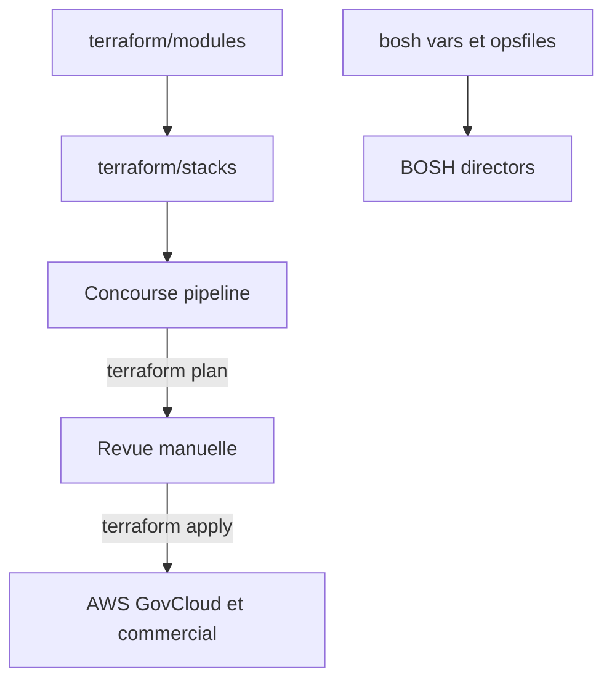

# cloud-gov/terraform-provision

> Configuration Terraform et BOSH qui amorce l'infrastructure de la plateforme cloud.gov.

## Le problème
Une plateforme multi-comptes et multi-régions demande une infrastructure décrite et déployée de façon contrôlée.

## Ce que ça fait vraiment
Le dépôt contient du Terraform organisé en modules et en stacks, plus des fichiers de variables BOSH. Les stacks main, tooling, regionalmasterbosh, external et dns couvrent les environnements. Rien n'est appliqué à la main : un pipeline Concourse lance plan, puis attend un déclenchement manuel pour apply.

## Comment c'est branché


## Essayer
```bash
pipx install pre-commit
pre-commit install
```

## Coût et pièges
Le README renvoie à une documentation interne non publique. Il faut des comptes AWS GovCloud et commerciaux et un Concourse déjà en place. La licence est présente mais non identifiée.

## Ce que ce n'est pas
Ce n'est pas un produit réutilisable : c'est la configuration privée d'une plateforme particulière. Le README avoue que la structure de spoke et base n'est pas claire.

## Alternatives
- Aucune alternative nommée dans le README.

## Pour toi
À ignorer : à lire tout au plus comme exemple d'organisation Terraform en modules et stacks, pas comme outil à adopter.

