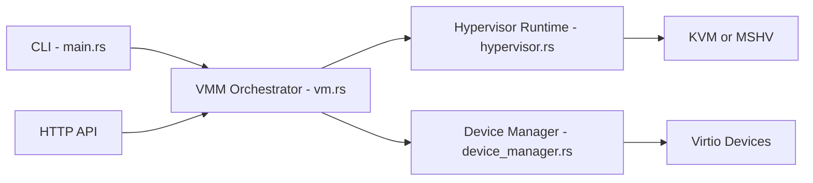

# cloud-hypervisor/cloud-hypervisor

> Virtual machine monitor written in Rust on KVM or MSHV, for modern cloud workloads.

## The problem
General-purpose hypervisors emulate too many legacy devices, which increases latency and attack surface.

## What it actually does
Rust VMM based on the rust-vmm crates: direct kernel boot or firmware boot, virtio devices, hotplug (CPU, memory, VFIO), machine-to-machine migration. x86-64 and AArch64 architectures (RISC-V experimental), 64-bit Linux guests and Windows 10/Server 2019. Driven by CLI or HTTP API.

## How it is wired


## Trying it
```bash
sudo setcap cap_net_admin+ep ./cloud-hypervisor
./create-cloud-init.sh
./cloud-hypervisor \
  --firmware ./hypervisor-fw \
  --disk path=focal-server-cloudimg-amd64.raw,image_type=raw path=/tmp/ubuntu-cloudinit.img,image_type=raw \
  --cpus boot=4 --memory size=1024M \
  --net "tap=,mac=,ip=,mask="
```

## Cost and gotchas
Host with kernel ≥ 6.8 and KVM. Demo credentials `cloud/cloud123`. Snapshot and migration not guaranteed across versions. No license detected by the catalog.

## What it is not
Not an orchestration platform: it is the monitor alone. No support for legacy devices.

## Alternatives
Firecracker and crosvm: oriented toward containers/serverless or clients, according to the README.

## For you
To watch: useful for isolating inference workloads in lightweight VMs; check the actual license first.
