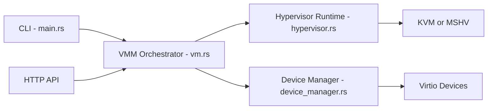

# cloud-hypervisor/cloud-hypervisor

> Moniteur de machines virtuelles en Rust sur KVM ou MSHV, pour charges de travail cloud modernes.

## Le problème
Les hyperviseurs généralistes émulent trop de périphériques hérités, ce qui augmente latence et surface d'attaque.

## Ce que ça fait vraiment
VMM Rust basé sur les crates rust-vmm : démarrage par noyau direct ou par firmware, périphériques virtio, hotplug (CPU, mémoire, VFIO), migration de machine à machine. Architectures x86-64 et AArch64 (RISC-V expérimental), invités Linux 64 bits et Windows 10/Server 2019. Pilotage par CLI ou API HTTP.

## Comment c'est branché


## Essayer
```bash
sudo setcap cap_net_admin+ep ./cloud-hypervisor
./create-cloud-init.sh
./cloud-hypervisor \
  --firmware ./hypervisor-fw \
  --disk path=focal-server-cloudimg-amd64.raw,image_type=raw path=/tmp/ubuntu-cloudinit.img,image_type=raw \
  --cpus boot=4 --memory size=1024M \
  --net "tap=,mac=,ip=,mask="
```

## Coût et pièges
Hôte avec noyau ≥ 6.8 et KVM. Identifiants de démonstration `cloud/cloud123`. Snapshot et migration non garantis entre versions. Aucune licence détectée par le catalogue.

## Ce que ce n'est pas
Pas une plateforme d'orchestration : c'est le moniteur seul. Pas de support des périphériques hérités.

## Alternatives
Firecracker et crosvm : orientés conteneurs/serverless ou clients, selon le README.

## Pour toi
À surveiller : utile pour isoler des charges d'inférence dans des VM légères ; vérifier d'abord la licence réelle.

