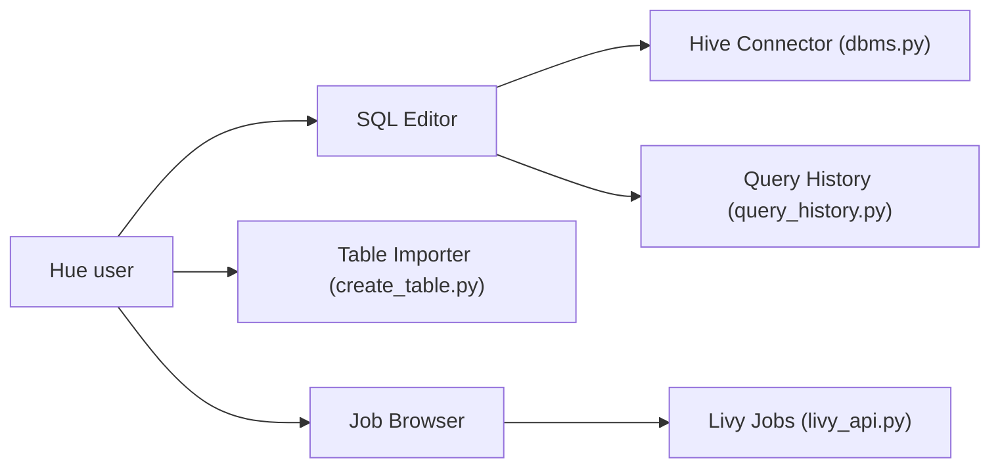

# cloudera/hue

> Web SQL assistant for querying databases and data warehouses, used in enterprises.

## The problem
Giving analysts a shared SQL editor, with a table and file browser, on top of Hive, Impala and other engines.

## What it actually does
Interactive SQL editor (highlighting, autocomplete), file browser (HDFS, S3, ABFS, Ozone, GS), job browser (Hive, Impala, YARN, Livy Spark), table browser and importer (CSV/Excel), multiple connectors (Hive, Impala, MySQL, PostgreSQL…), REST/Python/CLI API. The repository dates from 2010.

## How it is wired


## Trying it
```bash
docker run -it -p 8888:8888 gethue/hue:latest
helm repo add gethue https://helm.gethue.com
helm repo update
helm install hue gethue/hue
```

## Cost and gotchas
Free. The databases to query must be configured after startup. The "1000+ customers" claims come from the README and are unverified.

## What it is not
Not a BI tool nor a notebook. Oriented toward the Hadoop/data warehouse ecosystem; the README mentions no AI features.

## Alternatives
No alternative named in the README.

## For you
Keep an eye on it: relevant if your stack is Hive/Impala/Trino and you want a shared SQL editor; otherwise a notebook or a lighter SQL client is enough.
