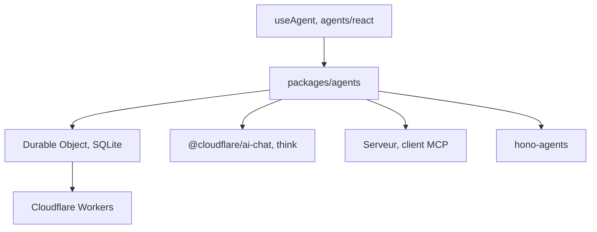

# cloudflare/agents

> TypeScript SDK for persistent AI agents on Cloudflare Durable Objects, with state, tools, MCP and workflows.

## The problem
An agent needs durable state, scheduled tasks and real time, which forces you to assemble a database, queues and sockets.

## What it actually does
Each agent is a Durable Object with SQLite state synchronized to clients, methods callable by RPC, WebSockets, scheduling (cron) and sub-agents. It acts as MCP server or client, handles AI chat, voice, email, workflows with human approval, and a "Code Mode" where the model writes TypeScript. More than 30 examples.

## How it is wired


## Trying it
```bash
npm create cloudflare@latest -- --template cloudflare/agents-starter
npm install agents
cd examples/playground
npm start
```

## Cost and gotchas
Cloudflare account, Durable Object binding and SQLite migration in wrangler.jsonc. Cloudflare usage-based billing (plan not detailed in the README). Node 24 required to contribute.

## What it is not
Not a neutral framework: it is tied to the Cloudflare platform. Some packages are deprecated (@cloudflare/shell, @cloudflare/voice) and the old ai-chat entry points need migrating.

## Alternatives
No alternative named in the README (OpenAI Agents SDK serves as examples in openai-sdk/).

## For you
Worth watching: solid for persistent conversational agents on Cloudflare, but your code would be locked to that provider.
