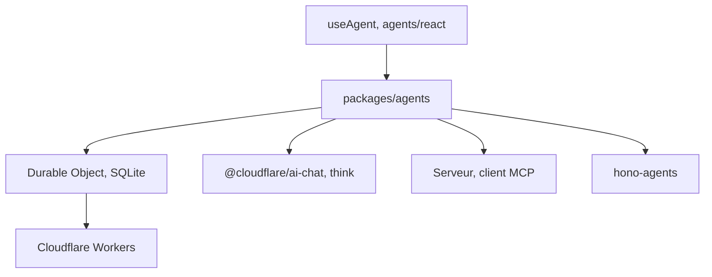

# cloudflare/agents

> SDK TypeScript pour agents IA persistants sur Cloudflare Durable Objects, avec état, outils, MCP et workflows.

## Le problème
Un agent a besoin d'un état durable, de tâches planifiées et de temps réel, ce qui oblige à assembler base, files et sockets.

## Ce que ça fait vraiment
Chaque agent est un Durable Object avec état SQLite synchronisé aux clients, méthodes appelables par RPC, WebSockets, planification (cron) et sous-agents. Il joue serveur ou client MCP, gère chat IA, voix, e-mail, workflows avec validation humaine, et un « Code Mode » où le modèle écrit du TypeScript. Plus de 30 exemples.

## Comment c'est branché


## Essayer
```bash
npm create cloudflare@latest -- --template cloudflare/agents-starter
npm install agents
cd examples/playground
npm start
```

## Coût et pièges
Compte Cloudflare, binding Durable Object et migration SQLite dans wrangler.jsonc. Facturation Cloudflare à l'usage (plan non détaillé dans le README). Node 24 requis pour contribuer.

## Ce que ce n'est pas
Pas un framework neutre : il est lié à la plateforme Cloudflare. Certains paquets sont dépréciés (@cloudflare/shell, @cloudflare/voice) et les anciens points d'entrée ai-chat sont à migrer.

## Alternatives
Aucune alternative nommée dans le README (OpenAI Agents SDK sert d'exemples dans openai-sdk/).

## Pour toi
À surveiller : solide pour des agents conversationnels persistants sur Cloudflare, mais ton code serait verrouillé sur ce fournisseur.

