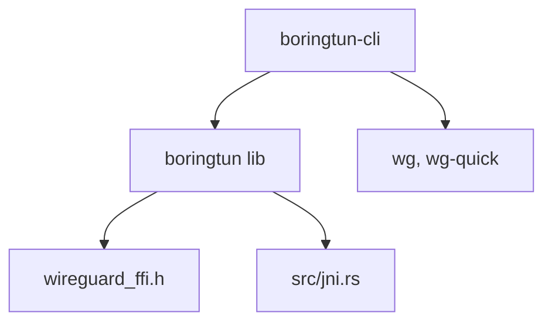

# cloudflare/boringtun

> Userspace implementation of the WireGuard protocol in Rust: library and executable for Linux and macOS.

## The problem
Using WireGuard on platforms without a kernel module, or embedding it in a mobile app, requires a portable implementation.

## What it actually does
Two parts: `boringtun-cli`, a userspace executable for Linux and macOS, and the `boringtun` library, which implements the protocol without a network stack and is usable on iOS and Android. The tunnel is configured with `wg` or `wg-quick`. C bindings (FFI) and JNI are provided. The README claims deployment on millions of devices and thousands of Cloudflare servers.

## How it is wired
Simplified diagram based on the sheet, no diagram provided.



## Trying it
```bash
cargo install boringtun-cli
boringtun-cli [-f/--foreground] INTERFACE-NAME
sudo WG_QUICK_USERSPACE_IMPLEMENTATION=boringtun-cli WG_SUDO=1 wg-quick up CONFIGURATION
```

## Cost and gotchas
Free. Real need: Rust toolchain (cargo), root rights or the `CAP_NET_ADMIN` capability, and Docker plus sudo to run the tests. The README warns of an ongoing restructuring: do not rely on the master branch, use crates.io.

## What it is not
Not a turnkey VPN: you need a WireGuard configuration and a peer server. Not a managed service.

## Alternatives
- wireguard-go: same targeted behavior, cited in the README as a reference.

## For you
Worth watching: useful for secure network access to GPU machines or clusters, but the ongoing restructuring means you should use the published releases.
