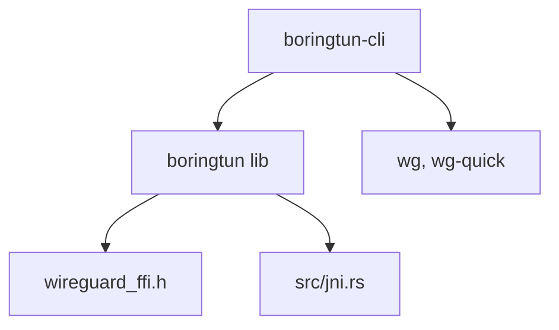

# cloudflare/boringtun

> Implémentation userspace du protocole WireGuard en Rust : bibliothèque et exécutable pour Linux et macOS.

## Le problème
Utiliser WireGuard sur des plateformes sans module noyau, ou l'intégrer dans une appli mobile, demande une implémentation portable.

## Ce que ça fait vraiment
Deux parties : `boringtun-cli`, exécutable userspace pour Linux et macOS, et la bibliothèque `boringtun` qui implémente le protocole sans pile réseau, utilisable sur iOS et Android. Le tunnel se configure avec `wg` ou `wg-quick`. Des bindings C (FFI) et JNI sont fournis. Le README annonce un déploiement sur des millions d'appareils et des milliers de serveurs Cloudflare.

## Comment c'est branché
Schéma simplifié d'après la fiche, sans diagramme fourni.



## Essayer
```bash
cargo install boringtun-cli
boringtun-cli [-f/--foreground] INTERFACE-NAME
sudo WG_QUICK_USERSPACE_IMPLEMENTATION=boringtun-cli WG_SUDO=1 wg-quick up CONFIGURATION
```

## Coût et pièges
Gratuit. Besoin réel : toolchain Rust (cargo), droits root ou la capacité `CAP_NET_ADMIN`, et Docker plus sudo pour lancer les tests. Le README avertit d'une restructuration en cours : ne pas s'appuyer sur la branche master, utiliser crates.io.

## Ce que ce n'est pas
Pas un VPN clé en main : il faut une configuration WireGuard et un serveur pair. Pas un service géré.

## Alternatives
- wireguard-go : comportement visé identique, cité dans le README comme référence.

## Pour toi
À surveiller : utile pour un accès réseau sécurisé vers des machines GPU ou des clusters, mais la restructuration en cours impose d'utiliser les versions publiées.

