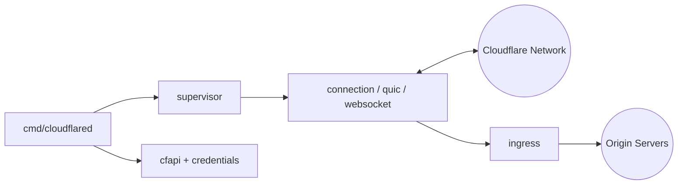

# cloudflare/cloudflared

> Command-line daemon that connects an internal service to the Cloudflare network, for infra and devops teams.

## The problem
Exposing an internal service on the Internet means opening ports on the firewall. Here, the origin can stay closed: the daemon opens the outbound connection.

## What it actually does
- The daemon sits between the Cloudflare network and the origin (web server, etc.) and relays traffic.
- `cloudflared tunnel` creates and serves tunnels; `cloudflared access` lets you reach protected origins over TCP (layer 4), for example SSH or RDP.
- Traffic is routed through public DNS records, through a Cloudflare load balancer, or from the WARP client.
- From the code: QUIC, HTTP2 and WebSocket modules, ingress rules, reconnection supervision, metrics and tracing.

## How it is wired


## Trying it
```bash
make cloudflared        # compilation depuis les sources (Go, GNU Make, capnp requis)
cloudflared tunnel help
cloudflared access help
```
The README points to the Cloudflare documentation for creating a tunnel; the exact commands are not given there.

## Cost and gotchas
A Cloudflare account is required and, for historical reasons according to the README, a site added with its name servers at Cloudflare. TryCloudflare lets you test without a site. Only versions less than a year old are supported.

## What it is not
Not a standalone tunnel: it only works with the Cloudflare network; it is neither a general-purpose VPN nor an end-to-end self-hostable tool. Removal of options is announced in the changelog before the version that removes them.

## Alternatives
- WARP client: access to private origins behind a tunnel without `cloudflared access` on the client side.

## For you
Useful if you need to expose a model service or an internal dashboard without opening a port, provided you accept the dependency on Cloudflare: worth watching rather than adopting by default.
