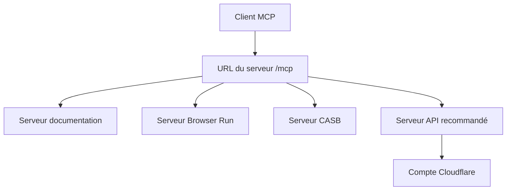

# cloudflare/mcp-server-cloudflare

> Remote MCP servers to drive a Cloudflare account in natural language from Claude or Cursor.

## The problem
Administering Cloudflare (DNS, logs, security, Workers) goes through the dashboard or the API. An AI client cannot act on the account without a standardized bridge.

## What it actually does
Offers one MCP server per domain (documentation, containers, Browser Run, DEX, CASB, blog) over stateless HTTP on `/mcp`. The old `/sse` path returns a 410 error. Several servers are deprecated in favor of the recommended API MCP server, maintained in `cloudflare/mcp`.

## How it is wired
Simplified diagram based on the sheet, no diagram provided.

## Trying it
The README gives no command: it asks you to connect a compatible MCP client to the URLs in the table, for example `https://docs.mcp.cloudflare.com/mcp`.

## Cost and gotchas
A Cloudflare account is required, with an API token that has the right permissions. Some features require a paid Workers plan.

## What it is not
It is not a server to host yourself: these are access points hosted by Cloudflare. The recommended server is not in this repository.

## Alternatives
`cloudflare/mcp`: the recommended API MCP server, for broad API coverage through code execution.

## For you
Watch: useful if your infrastructure is on Cloudflare, but part of the servers are deprecated and everything depends on a Cloudflare account.
