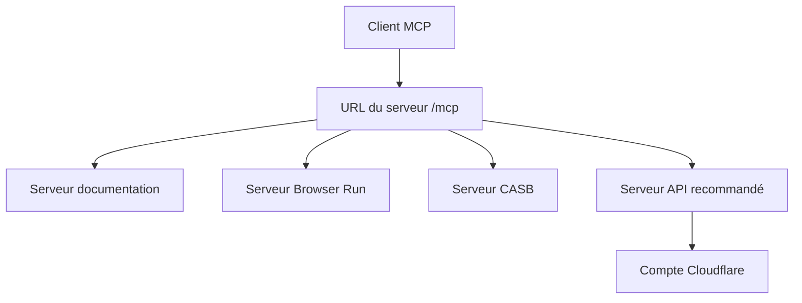

# cloudflare/mcp-server-cloudflare

> Serveurs MCP distants pour piloter un compte Cloudflare en langage naturel depuis Claude ou Cursor.

## Le problème
Administrer Cloudflare (DNS, journaux, sécurité, Workers) passe par le tableau de bord ou l'API. Un client IA ne peut pas agir sur le compte sans pont standardisé.

## Ce que ça fait vraiment
Propose des serveurs MCP par domaine (documentation, conteneurs, Browser Run, DEX, CASB, blog) en HTTP sans état sur `/mcp`. L'ancien chemin `/sse` renvoie une erreur 410. Plusieurs serveurs sont dépréciés au profit du serveur API MCP recommandé, maintenu dans `cloudflare/mcp`.

## Comment c'est branché
Schéma simplifié d'après la fiche, sans diagramme fourni.

## Essayer
Le README ne donne aucune commande : il demande de connecter un client MCP compatible aux URL du tableau, par exemple `https://docs.mcp.cloudflare.com/mcp`.

## Coût et pièges
Un compte Cloudflare est requis, avec un jeton d'API aux bonnes permissions. Certaines fonctions demandent un plan Workers payant.

## Ce que ce n'est pas
Ce n'est pas un serveur à héberger : ce sont des points d'accès hébergés par Cloudflare. Le serveur recommandé n'est pas dans ce dépôt.

## Alternatives
`cloudflare/mcp` : serveur API MCP recommandé, pour une couverture large des API par exécution de code.

## Pour toi
Surveiller : utile si ton infra est chez Cloudflare, mais une partie des serveurs est dépréciée et tout dépend d'un compte Cloudflare.

