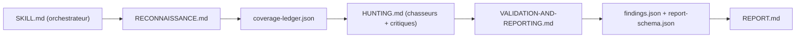

# cloudflare/security-audit-skill

> Skill for a coding agent that audits a repository's security in six phases, with isolated agents.

## The problem
A manual security audit is slow, and a single agent that "looks at the code" confirms its own leads too quickly.

## What it actually does
The skill is mostly prompts and schemas. It splits the audit into reconnaissance, hunting guided by a coverage grid, adversarial validation of each candidate, structured output, independent verification, then reports. Only two dependency-free Node validators (`validate-findings.cjs`, `validate-coverage-ledger.cjs`) are real code. The verdicts are `confirmed`, `needs_validation` or `rejected`. Several passes on the same repository add up.

## How it is wired


## Trying it
```bash
npx skills add https://github.com/cloudflare/security-audit-skill \
  --skill security-audit
```
Then, in the agent: `security audit this codebase`.

## Cost and gotchas
Many sub-agents in parallel: the token bill is on you, and the README does not quantify it. The target code must only be run in a sandbox that cuts off the network; without one, the lead stays `needs_validation`.

## What it is not
It is not Cloudflare's fleet harness, only its starting point for a single repository. It is not a deterministic scanner: results depend on the model. The README claims that several passes find about twice as much as a single one, with no proof provided here.

## Alternatives
No alternative named in the README.

## For you
Worth watching: the method (adversarial validation, coverage grid) deserves to be copied to audit agent or pipeline code, but the token cost and the mandatory sandbox call for a measured trial before adopting it.
