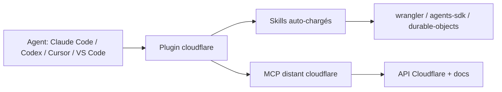

# cloudflare/skills

> Collection of installable agent skills and a plugin for developing on the Cloudflare platform, for agent developers.

## The problem
A coding agent knows recent Cloudflare products (Workers, Durable Objects, Agents SDK) poorly and suggests outdated APIs or the wrong product.

## What it actually does
Provides about twenty skills loaded automatically when the conversation matches their triggers: Workers, Wrangler, Durable Objects, Agents SDK, Sandbox, Turnstile, email, web-perf, Cloudflare One. The plugin also bundles the remote "cloudflare" MCP server (API and current documentation, in Code Mode). The other product MCP servers are deliberately not included.

## How it is wired


## Trying it
```bash
# Claude Code
/plugin marketplace add cloudflare/skills
/plugin install cloudflare@cloudflare

# Codex
codex plugin marketplace add cloudflare/skills
codex plugin add cloudflare@cloudflare

# Agents compatibles Agent Skills
npx skills add https://github.com/cloudflare/skills
```

## Cost and gotchas
The skills are free (Apache-2.0), but the MCP server and the product code target Cloudflare services whose usage is billed according to your account. The Sandbox skills exist in stable and `@next` (1.0 preview) variants: pick the right one.

## What it is not
Not an SDK or a runtime library: these are instructions for agents. It does not replace the Cloudflare documentation and is useless outside this ecosystem. The README does not describe the detailed content of each skill.

## Alternatives
No alternative named in the README.

## For you
Adopt if you deploy agents or Workers on Cloudflare: installation takes two commands, it is maintained by the vendor (last push 2026-10-19); without Cloudflare, no interest.
