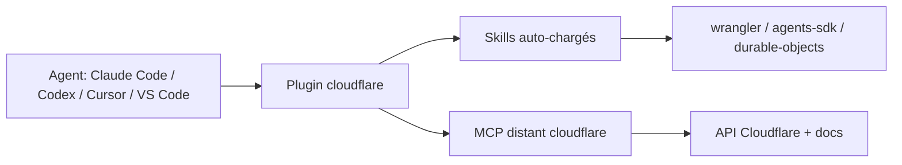

# cloudflare/skills

> Collection de skills d'agents et de plugin installables pour développer sur la plateforme Cloudflare, pour les développeurs d'agents.

## Le problème
Un agent de code connaît mal les produits Cloudflare récents (Workers, Durable Objects, Agents SDK) et propose des API périmées ou le mauvais produit.

## Ce que ça fait vraiment
Fournit une vingtaine de skills chargés automatiquement quand la conversation correspond à leurs déclencheurs : Workers, Wrangler, Durable Objects, Agents SDK, Sandbox, Turnstile, email, web-perf, Cloudflare One. Le plugin embarque aussi le serveur MCP distant « cloudflare » (API et documentation courante, en Code Mode). Les autres serveurs MCP produit ne sont volontairement pas inclus.

## Comment c'est branché


## Essayer
```bash
# Claude Code
/plugin marketplace add cloudflare/skills
/plugin install cloudflare@cloudflare

# Codex
codex plugin marketplace add cloudflare/skills
codex plugin add cloudflare@cloudflare

# Agents compatibles Agent Skills
npx skills add https://github.com/cloudflare/skills
```

## Coût et pièges
Les skills sont gratuits (Apache-2.0), mais le serveur MCP et le code produit visent des services Cloudflare dont l'usage est facturé selon ton compte. Les skills Sandbox existent en variantes stable et `@next` (préversion 1.0) : choisir la bonne.

## Ce que ce n'est pas
Ce n'est pas un SDK ni une bibliothèque d'exécution : ce sont des instructions pour agents. Il ne remplace pas la documentation Cloudflare et ne sert à rien hors de cet écosystème. Le README ne décrit pas le contenu détaillé de chaque skill.

## Alternatives
Aucune alternative nommée dans le README.

## Pour toi
Adopter si tu déploies agents ou Workers sur Cloudflare : l'installation tient en deux commandes, c'est maintenu par l'éditeur (dernier push 2026-10-19) ; sans Cloudflare, aucun intérêt.

