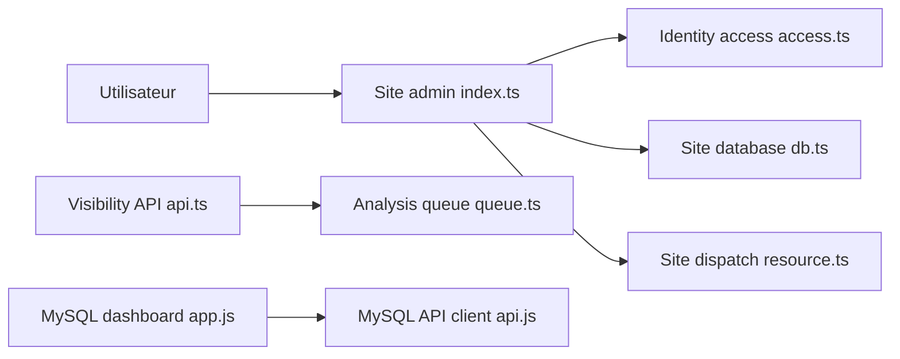

# cloudflare/templates

> Official collection of starter templates for full-stack applications on Cloudflare Workers.

## The problem
Starting an application on Workers requires assembling configuration, bindings and deployment. A ready-made template avoids starting from scratch.

## What it actually does
The repository groups `*-template` folders, each with its own `dev` script. According to the architecture found, it includes notably site hosting with administration, a multi-tenant platform, an AI visibility report with an analysis queue, MySQL/Postgres dashboards and a workflow demo. A Playwright suite tests each template, locally or on the deployed version.

## How it is wired


## Trying it
```bash
npm create cloudflare@latest
pnpm create cloudflare@latest
yarn create cloudflare@latest
pnpm run test:e2e
pnpm run test:e2e:live
```

## Cost and gotchas
The repository is free (MIT), but deployment assumes a Cloudflare account; the services used (database, queue, AI) may be billed depending on the plan. 197 open issues.

## What it is not
Not a single application nor a framework: starter examples, coupled to the Cloudflare platform. The graph covers only part of the templates.

## Alternatives
- No alternative cited in the README.

## For you
Worth watching: useful for prototyping an API or a lightweight dashboard on Workers, but of no direct interest if your data / AI chain is not already on Cloudflare.
