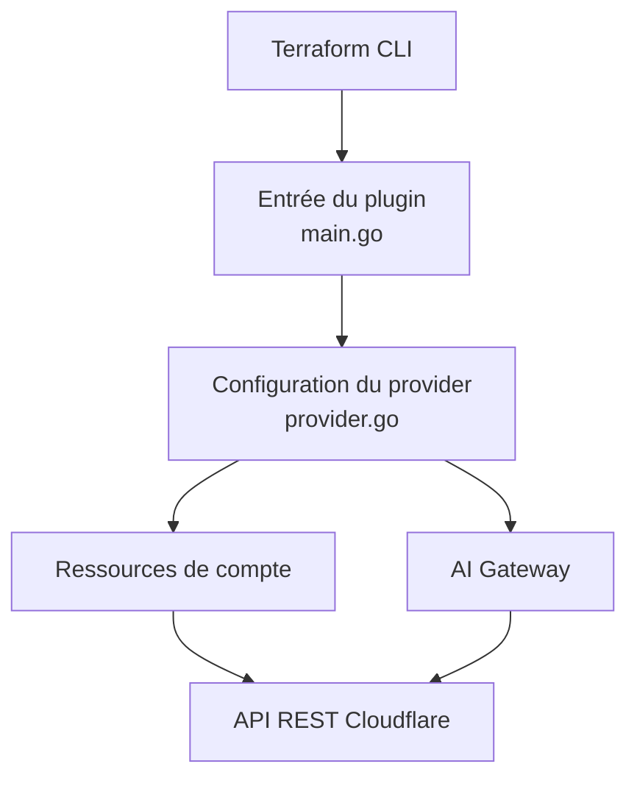

# cloudflare/terraform-provider-cloudflare

> Official Terraform provider that exposes Cloudflare's REST API as declarative resources and data sources.

## The problem
Manually managing Cloudflare DNS zones, certificates and security rules through the web interface does not fit into a versioned infrastructure-as-code workflow.

## What it actually does
Provides Terraform resources (`cloudflare_zone`, etc.) that create and manage Cloudflare objects via the REST API: accounts, access rules, API Shield, content scanning, certificates, AI Gateway, AI Search. Automatically generated and maintained internally by Cloudflare; no longer accepts community pull requests.

## How it is wired


## Trying it
```hcl
terraform {
  required_providers {
    cloudflare = {
      source  = "cloudflare/cloudflare"
      version = "~> 5.28.0"
    }
  }
}
provider "cloudflare" {
  api_token = "votre_token"
}
```

## Cost and gotchas
The provider itself is free, but requires a Cloudflare account and a valid API key/token; some covered Cloudflare features may be paid depending on the plan. Auto-generated project, community fixes go through issues, not pull requests.

## What it is not
Not an AI tool: it is a classic infrastructure-as-code provider for Cloudflare. Only manages what the Cloudflare API exposes, nothing on the model or data side beyond Cloudflare's AI Gateway/AI Search products.

## Alternatives
No alternative named in the README.

## For you
Ignore for a generic data/AI/MLOps profile, unless the target infrastructure already relies on Cloudflare (DNS, security, AI Gateway) and needs Terraform provisioning.
