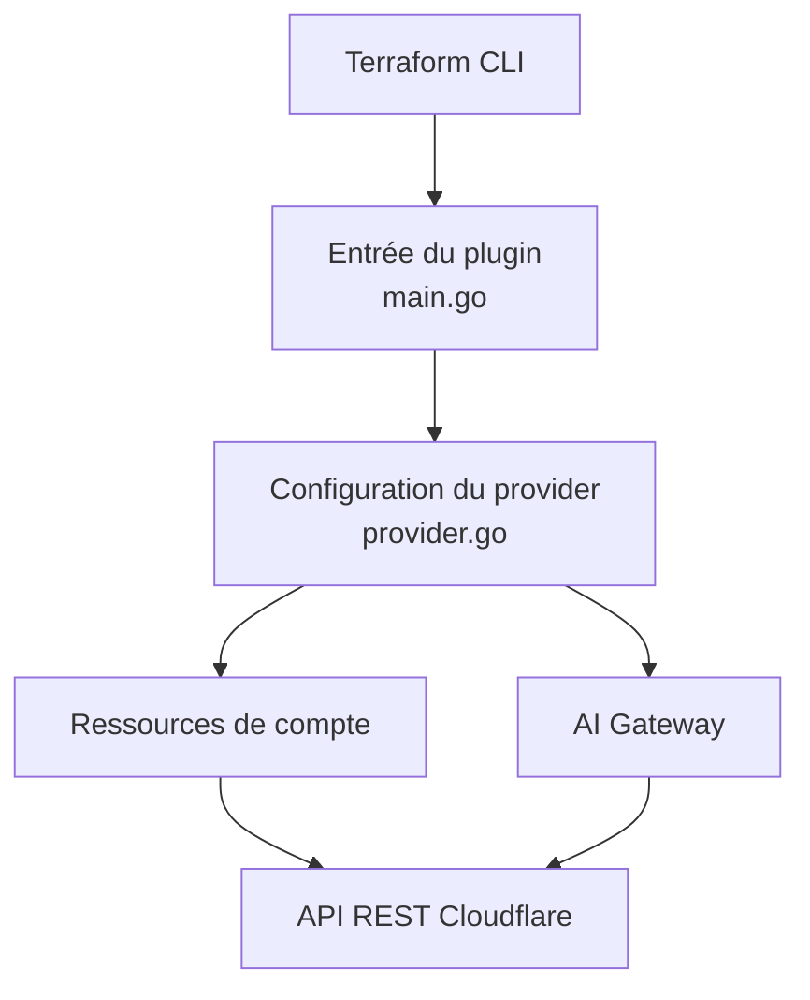

# cloudflare/terraform-provider-cloudflare

> Provider Terraform officiel qui expose l'API REST de Cloudflare comme ressources et sources de données déclaratives.

## Le problème
Gérer manuellement les zones DNS, certificats et règles de sécurité Cloudflare via l'interface web ne s'intègre pas à un flux d'infrastructure-as-code versionné.

## Ce que ça fait vraiment
Fournit des ressources Terraform (`cloudflare_zone`, etc.) qui créent et gèrent des objets Cloudflare via l'API REST : comptes, règles d'accès, API Shield, scan de contenu, certificats, AI Gateway, AI Search. Généré automatiquement et maintenu en interne par Cloudflare ; ne prend plus de pull requests communautaires.

## Comment c'est branché


## Essayer
```hcl
terraform {
  required_providers {
    cloudflare = {
      source  = "cloudflare/cloudflare"
      version = "~> 5.28.0"
    }
  }
}
provider "cloudflare" {
  api_token = "votre_token"
}
```

## Coût et pièges
Le provider lui-même est gratuit, mais nécessite un compte Cloudflare et une clé d'API/token valide ; certaines fonctionnalités Cloudflare couvertes peuvent être payantes selon le plan. Projet auto-généré, les correctifs communautaires passent par des issues, pas des pull requests.

## Ce que ce n'est pas
Pas un outil IA : c'est un provider d'infrastructure-as-code classique pour Cloudflare. Ne gère que ce que l'API Cloudflare expose, rien côté modèles ou données au-delà des produits AI Gateway/AI Search de Cloudflare.

## Alternatives
Aucune alternative nommée dans le README.

## Pour toi
À ignorer pour un profil data/IA/MLOps générique, sauf si l'infrastructure cible repose déjà sur Cloudflare (DNS, sécurité, AI Gateway) et nécessite un provisionnement Terraform.

