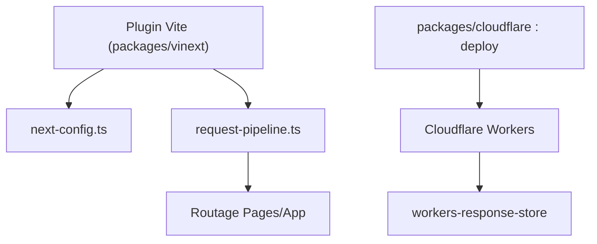

# cloudflare/vinext

> Vite plugin that reimplements the Next.js API to run Next.js applications on Cloudflare Workers.

## The problem
Deploying Next.js outside Vercel means output adapters or heavy self-hosting.

## What it actually does
Reimplements App Router, Pages Router, RSC, Server Actions, middleware, ISR and the common `next/*` modules on Vite 8. Provides `vinext init`, `vinext check` and a Cloudflare deployment (`@vinext/cloudflare deploy`) with bindings, CDN cache and image optimization. Other targets go through Nitro. The README announces known compatibility gaps.

## How it is wired


## Trying it
```bash
pnpm create vinext-app@latest my-app
npx vinext init
npx vite dev
npx @vinext/cloudflare deploy
```

## Cost and gotchas
Deployment requires a Cloudflare account and `CLOUDFLARE_API_TOKEN` or `cf auth login`. Native modules (sharp, canvas) do not work on Workers.

## What it is not
Not a fork of Next.js, nor a guaranteed replacement: the README itself says it is not ready for every production workload. No link with data or AI.

## Alternatives
OpenNext (more mature, relies on the output of `next build`); self-hosting Next.js.

## For you
Ignore: web front-end tool unrelated to a data / AI / MLOps profile, and still experimental.
