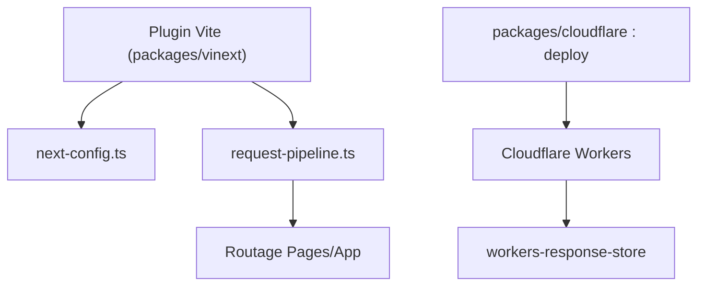

# cloudflare/vinext

> Plugin Vite qui réimplémente l'API Next.js pour exécuter des applications Next.js sur Cloudflare Workers.

## Le problème
Déployer Next.js hors Vercel passe par des adaptateurs de sortie ou un auto-hébergement lourd.

## Ce que ça fait vraiment
Réimplémente App Router, Pages Router, RSC, Server Actions, middleware, ISR et les modules `next/*` courants sur Vite 8. Fournit `vinext init`, `vinext check` et un déploiement Cloudflare (`@vinext/cloudflare deploy`) avec bindings, cache CDN et optimisation d'images. D'autres cibles passent par Nitro. Le README annonce des écarts de compatibilité connus.

## Comment c'est branché


## Essayer
```bash
pnpm create vinext-app@latest my-app
npx vinext init
npx vite dev
npx @vinext/cloudflare deploy
```

## Coût et pièges
Le déploiement exige un compte Cloudflare et `CLOUDFLARE_API_TOKEN` ou `cf auth login`. Les modules natifs (sharp, canvas) ne fonctionnent pas sur Workers.

## Ce que ce n'est pas
Pas un fork de Next.js, ni un remplaçant garanti : le README dit lui-même qu'il n'est pas prêt pour toute charge de production. Aucun lien avec data ou IA.

## Alternatives
OpenNext (plus mature, repose sur la sortie de `next build`) ; l'auto-hébergement de Next.js.

## Pour toi
Ignorer : outil de front-end web sans rapport avec un profil data / IA / MLOps, et encore expérimental.

