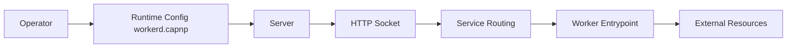

# cloudflare/workerd

> Cloudflare Workers' JavaScript/Wasm runtime, for self-hosting, local testing or HTTP proxying.

## The problem
Running code written for Workers outside Cloudflare, or testing it locally with the same behavior.

## What it actually does
A server configured by a Cap'n Proto file: services, sockets, workers, capability-based bindings. Standard web APIs (`fetch`, streams), Durable Objects, Node compatibility and a Python runtime. Dated releases with a "compatibility date" for backward compatibility.

## How it is wired


## Trying it
```bash
npx workerd ...
workerd serve my-config.capnp
```

## Cost and gotchas
Free, Apache-2.0. Heavy build (Bazel, clang 22+). The README warns: it is not a hardened sandbox; for malicious code, isolate it in a VM.

## What it is not
Not a copy of Cloudflare's hosting: it lacks its additional layers of defense.

## Alternatives
Wrangler (v3+) for local Workers development, via Miniflare.

## For you
Watch: useful if you deploy Workers; otherwise unrelated to data/AI.
