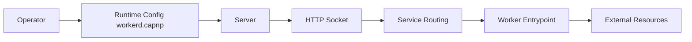

# cloudflare/workerd

> Runtime JavaScript/Wasm de Cloudflare Workers, pour auto-héberger, tester en local ou faire proxy HTTP.

## Le problème
Exécuter hors de Cloudflare le code écrit pour Workers, ou le tester localement avec le même comportement.

## Ce que ça fait vraiment
Serveur configuré par un fichier Cap'n Proto : services, sockets, workers, liaisons par capacités. API web standard (`fetch`, flux), Durable Objects, compatibilité Node et un runtime Python. Versions datées avec « compatibility date » pour la rétrocompatibilité.

## Comment c'est branché


## Essayer
```bash
npx workerd ...
workerd serve my-config.capnp
```

## Coût et pièges
Gratuit, Apache-2.0. Compilation lourde (Bazel, clang 22+). Le README prévient : ce n'est pas un bac à sable durci ; pour du code malveillant, l'isoler dans une VM.

## Ce que ce n'est pas
Pas une copie de l'hébergement Cloudflare : sans ses couches de défense supplémentaires.

## Alternatives
Wrangler (v3+) pour le développement local de Workers, via Miniflare.

## Pour toi
Surveiller : utile si tu déploies des Workers ; sinon sans lien avec data/IA.

