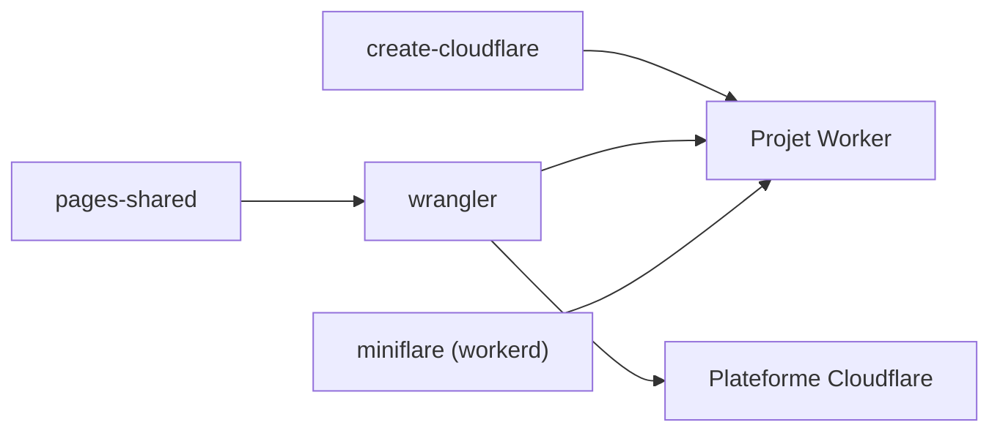

# cloudflare/workers-sdk

> Official tools for developing and deploying serverless code on Cloudflare Workers.

## The problem
Deploying serverless code worldwide requires tools for creation, local simulation and deployment.

## What it actually does
A repository that groups `wrangler` (command line), `create-cloudflare` (project creation), `miniflare` (local simulator based on workerd), packages shared with Pages and a version of Chrome DevTools for inspecting Workers. Beta versions are published on every commit via pkg.pr.new.

## How it is wired

Simplified diagram based on the sheet, no diagram provided.

## Trying it
```bash
npm create cloudflare@latest
pnpm create cloudflare@latest
yarn create cloudflare@latest
```

## Cost and gotchas
The tools are free, but deployment requires a Cloudflare account, with paid plans beyond the free quota (not detailed in the README). Beta versions are not suitable for a stable project.

## What it is not
It is not portable: everything targets the Cloudflare platform. It is not an application framework, only tooling.

## Alternatives
No alternative named in the README.

## For you
Ignore, unless you already deploy on Cloudflare: it is serverless web tooling, with no direct link to data, AI or MLOps work.
