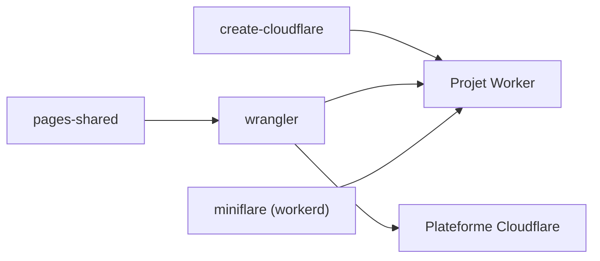

# cloudflare/workers-sdk

> Outils officiels pour développer et déployer du code serverless sur Cloudflare Workers.

## Le problème
Déployer du code serverless à l'échelle mondiale demande des outils de création, de simulation locale et de déploiement.

## Ce que ça fait vraiment
Dépôt qui regroupe `wrangler` (ligne de commande), `create-cloudflare` (création de projets), `miniflare` (simulateur local basé sur workerd), des paquets partagés avec Pages et une version de Chrome DevTools pour inspecter des Workers. Des versions bêta sont publiées à chaque commit via pkg.pr.new.

## Comment c'est branché

Schéma simplifié d'après la fiche, sans diagramme fourni.

## Essayer
```bash
npm create cloudflare@latest
pnpm create cloudflare@latest
yarn create cloudflare@latest
```

## Coût et pièges
Les outils sont gratuits, mais le déploiement exige un compte Cloudflare, avec des offres payantes au-delà du quota gratuit (non détaillé dans le README). Les versions bêta ne conviennent pas à un projet stable.

## Ce que ce n'est pas
Ce n'est pas portable : tout cible la plateforme Cloudflare. Ce n'est pas un framework applicatif, seulement l'outillage.

## Alternatives
Aucune alternative nommée dans le README.

## Pour toi
À ignorer, sauf si tu déploies déjà sur Cloudflare : c'est de l'outillage serverless web, sans lien direct avec un travail data, IA ou MLOps.

