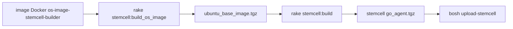

# cloudfoundry/bosh-linux-stemcell-builder

> Tools that build BOSH stemcells, the boot disk images used by a BOSH Director.

## The problem
A BOSH Director needs VM images prepared for each IaaS; producing them by hand is not reproducible.

## What it actually does
First builds an Ubuntu OS image (tarball), then adds the BOSH agent and the virtualization tools for a given IaaS (aws, azure, google, openstack, vsphere). Everything runs in a privileged Docker container, with rspec tests on the image. The repository also describes the Concourse pipeline and the associated GCS and AWS buckets.

## How it is wired
Simplified diagram based on the sheet, no diagram provided.



## Trying it
```bash
export short_name="jammy"
git clone git@github.com:cloudfoundry/bosh-linux-stemcell-builder.git
cd bosh-linux-stemcell-builder
git checkout ubuntu-${short_name}
bundle exec rake stemcell:build_os_image[ubuntu,${short_name},${PWD}/tmp/ubuntu_base_image.tgz]
bundle exec rake stemcell:build[vsphere,esxi,ubuntu,${short_name},${PWD}/tmp/ubuntu_base_image.tgz]
```
These rake tasks run inside the Docker container built beforehand (see the README).

## Cost and gotchas
Container launched with `--privileged`. For vSphere, you must manually download VMware's `ovftool` installer before the `docker build`. The pipeline assumes Concourse, GCP and AWS.

## What it is not
Not a tool for deploying VMs: it only produces the images. It is useless without a BOSH Director.

## Alternatives
No alternative named in the README.

## For you
Ignore: reserved for those who operate BOSH and Cloud Foundry, very far from a data, AI or MLOps daily routine.
