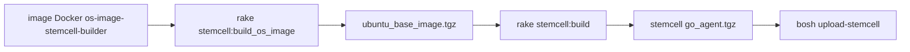

# cloudfoundry/bosh-linux-stemcell-builder

> Outils qui fabriquent les stemcells BOSH, images disque d'amorçage utilisées par un Director BOSH.

## Le problème
Un Director BOSH a besoin d'images de VM préparées pour chaque IaaS ; les produire à la main n'est pas reproductible.

## Ce que ça fait vraiment
Construit d'abord une image d'OS Ubuntu (tarball), puis ajoute l'agent BOSH et les outils de virtualisation pour un IaaS donné (aws, azure, google, openstack, vsphere). Le tout tourne dans un conteneur Docker privilégié, avec des tests rspec sur l'image. Le dépôt décrit aussi le pipeline Concourse et les buckets GCS et AWS associés.

## Comment c'est branché
Schéma simplifié d'après la fiche, sans diagramme fourni.



## Essayer
```bash
export short_name="jammy"
git clone git@github.com:cloudfoundry/bosh-linux-stemcell-builder.git
cd bosh-linux-stemcell-builder
git checkout ubuntu-${short_name}
bundle exec rake stemcell:build_os_image[ubuntu,${short_name},${PWD}/tmp/ubuntu_base_image.tgz]
bundle exec rake stemcell:build[vsphere,esxi,ubuntu,${short_name},${PWD}/tmp/ubuntu_base_image.tgz]
```
Ces rake s'exécutent dans le conteneur Docker construit au préalable (voir le README).

## Coût et pièges
Conteneur lancé en `--privileged`. Pour vSphere, il faut télécharger à la main l'installeur `ovftool` de VMware avant le `docker build`. Le pipeline suppose Concourse, GCP et AWS.

## Ce que ce n'est pas
Pas un outil pour déployer des VM : il produit seulement les images. Il est inutile sans un Director BOSH.

## Alternatives
Aucune alternative nommée dans le README.

## Pour toi
À ignorer : réservé à qui exploite BOSH et Cloud Foundry, très loin d'un quotidien data, IA ou MLOps.

