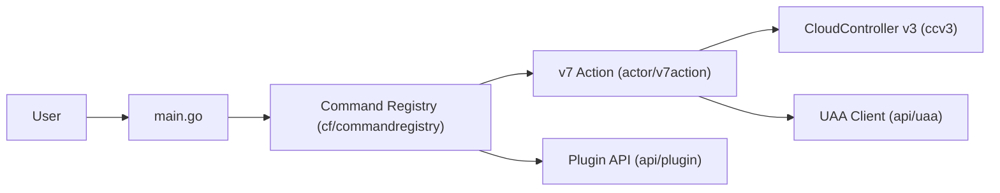

# cloudfoundry/cli

> Official Cloud Foundry command-line client, for developers and operators of that platform.

## The problem
Pushing and administering applications on a Cloud Foundry platform without a dedicated client forces you to call the API by hand.

## What it actually does
The `cf` command connects to the Cloud Controller API (v3 for v8), UAA, the router and Log Cache: login, app push, orgs, roles, ssh, plugins. Based on the code: Go, Command pattern, an "actor" layer between commands and API clients. v6 and v7 are no longer maintained.

## How it is wired


## Trying it
```bash
cf help -a
```
The README points to the download page for installation; no other command is given there.

## Cost and gotchas
Free, but useless without an accessible Cloud Foundry environment. Known issues on Windows (Cygwin, Git Bash) for `cf login` and `cf ssh`.

## What it is not
Not a platform: it is only the client. It is not a data or ML tool.

## Alternatives
No alternative named in the README.

## For you
Ignore, unless your company deploys on Cloud Foundry: nothing here serves everyday data or MLOps work.
