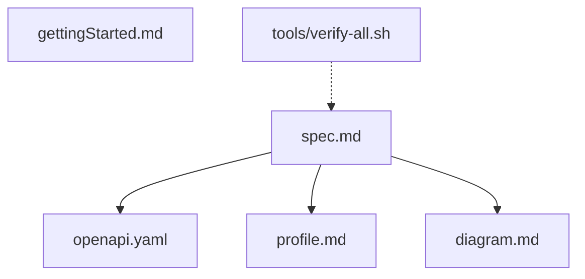

# cloudfoundry/servicebroker

> Open Service Broker API specification: how a platform provisions services through a broker.

## The problem
Without a standard, each cloud platform defines its own way of offering services (databases, queues) to its applications.

## What it actually does
A documentation repository: spec.md, broken down into openapi.yaml and a profile, plus guides (getting started, platform compatibility, release notes). The latest published version is 2.17. tools/ scripts check links, tables and formatting. Third-party conformance suites are listed.

## How it is wired

## Trying it
No documented command: the README points to the specification, the Getting Started document and the osb-checker conformance suites.

## Cost and gotchas
Free. It is not executable code: you have to implement a broker yourself.

## What it is not
Not a broker implementation or a platform: only the standard and its verification tools.

## Alternatives
osb-checker (Go) and osb-checker-kotlin verify your broker's conformance.

## For you
Ignore: a cloud infrastructure standard; useful only if you expose data services on Cloud Foundry or Kubernetes.
