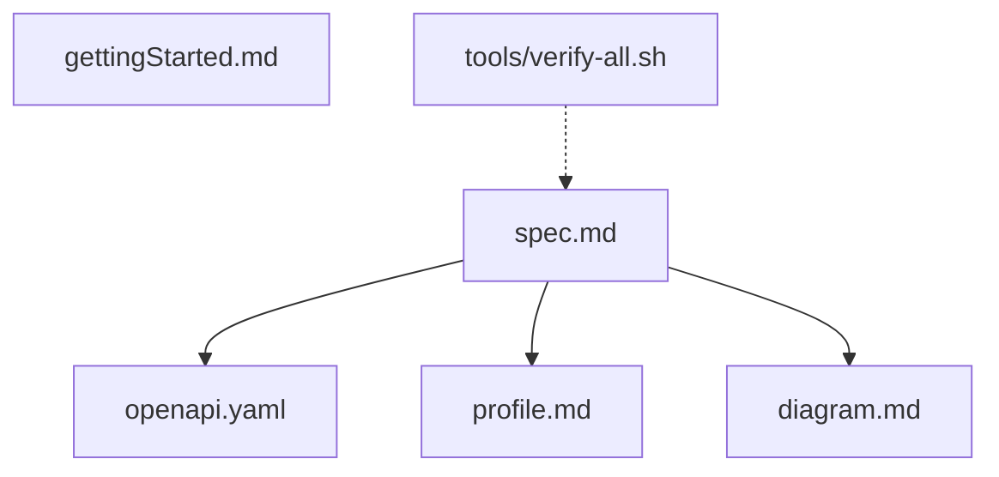

# cloudfoundry/servicebroker

> Spécification Open Service Broker API : comment une plateforme provisionne des services via un broker.

## Le problème
Sans standard, chaque plateforme cloud définit sa propre façon d'offrir des services (bases, files) à ses applications.

## Ce que ça fait vraiment
Dépôt de documentation : spec.md, décliné en openapi.yaml et en profil, plus des guides (démarrage, compatibilité des plateformes, notes de version). La dernière version publiée est 2.17. Des scripts tools/ vérifient liens, tableaux et formatage. Des suites de conformité tierces sont listées.

## Comment c'est branché

## Essayer
Aucune commande documentée : le README renvoie vers la spécification, le document Getting Started et les suites de conformité osb-checker.

## Coût et pièges
Gratuit. Ce n'est pas un code exécutable : il faut implémenter un broker soi-même.

## Ce que ce n'est pas
Pas une implémentation de broker ni une plateforme : seulement la norme et ses outils de vérification.

## Alternatives
osb-checker (Go) et osb-checker-kotlin vérifient la conformité de ton broker.

## Pour toi
Ignorer : norme d'infrastructure cloud ; utile seulement si tu exposes des services de données sur Cloud Foundry ou Kubernetes.

