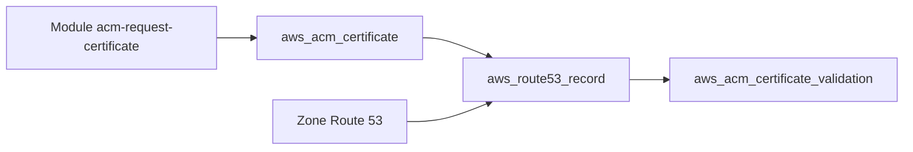

# cloudposse/terraform-aws-acm-request-certificate

> Terraform module that requests an AWS ACM certificate and creates the DNS validation record.

## The problem
Validating an ACM certificate by DNS by hand means copying the CNAME record into Route 53.

## What it actually does
Creates `aws_acm_certificate`, the validation `aws_route53_record` and `aws_acm_certificate_validation`. Takes a domain name, alternative names (for example `*.example.com`), the TTL and the Route 53 zone by name or ID. The default method is DNS.

## How it is wired
Simplified diagram based on the sheet, no diagram provided.



## Trying it
```hcl
module "acm_request_certificate" {
  source = "cloudposse/acm-request-certificate/aws"
  domain_name                       = "example.com"
  process_domain_validation_options = true
  ttl                               = "300"
}
```

## Cost and gotchas
An AWS account with an existing Route 53 zone. Terraform 0.14 or later, AWS provider 6.4.0 or later. The last push dates from October 2025, more than a year ago.

## What it is not
Not a certificate renewal or deployment tool: it requests and validates, that's all. The `atmos` commands in the README are for testing.

## Alternatives
- terraform-aws-alb: the load balancer module that then uses the certificate.

## For you
Watch: a plain, correct module for exposing an ML service over HTTPS on AWS, but old; two resources you can write yourself.
