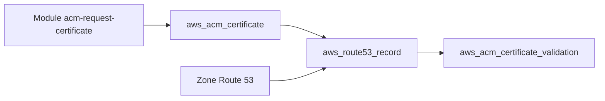

# cloudposse/terraform-aws-acm-request-certificate

> Module Terraform qui demande un certificat ACM AWS et crée l'enregistrement DNS de validation.

## Le problème
Valider à la main un certificat ACM par DNS demande de copier l'enregistrement CNAME dans Route 53.

## Ce que ça fait vraiment
Crée `aws_acm_certificate`, l'enregistrement `aws_route53_record` de validation et `aws_acm_certificate_validation`. Prend un nom de domaine, des noms alternatifs (par exemple `*.example.com`), le TTL et la zone Route 53 par nom ou identifiant. La méthode par défaut est DNS.

## Comment c'est branché
Schéma simplifié d'après la fiche, sans diagramme fourni.



## Essayer
```hcl
module "acm_request_certificate" {
  source = "cloudposse/acm-request-certificate/aws"
  domain_name                       = "example.com"
  process_domain_validation_options = true
  ttl                               = "300"
}
```

## Coût et pièges
Compte AWS avec une zone Route 53 existante. Terraform 0.14 ou plus, provider AWS 6.4.0 ou plus. Le dernier push date d'octobre 2025, soit plus d'un an.

## Ce que ce n'est pas
Pas un outil de renouvellement ni de déploiement de certificat : il demande et valide, c'est tout. Les commandes `atmos` du README servent aux tests.

## Alternatives
- terraform-aws-alb : le module de répartiteur de charge qui utilise ensuite le certificat.

## Pour toi
Surveiller : module banal et correct pour exposer un service ML en HTTPS sur AWS, mais ancien ; deux ressources que tu peux écrire toi-même.

