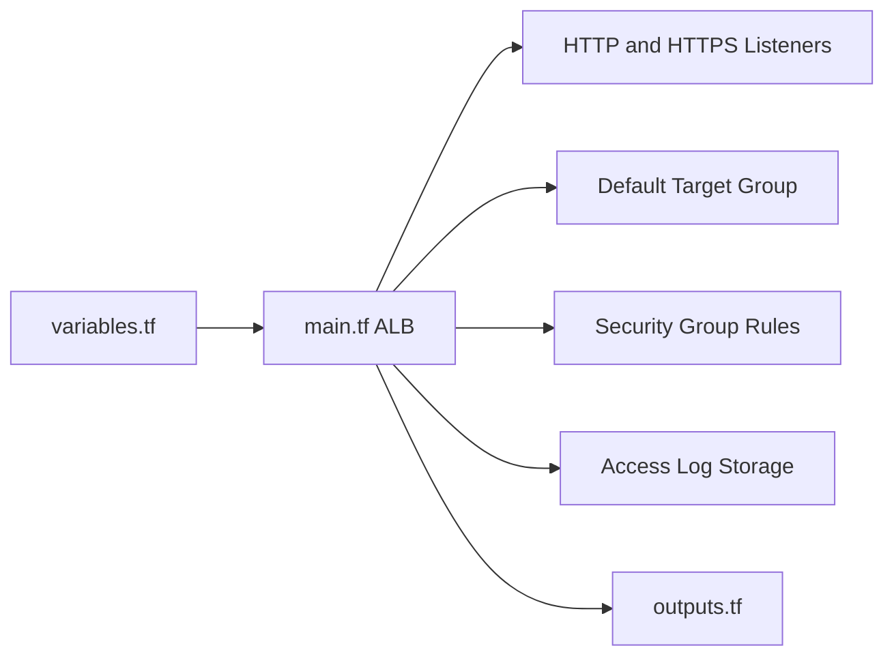

# cloudposse/terraform-aws-alb

> Terraform module creating an AWS ALB, its listeners, its default target and its security groups.

## The problem
An ALB requires HTTP/HTTPS listeners, redirects, security groups and a logs bucket, to be reconfigured for every project.

## What it actually does
Provisions `aws_lb`, HTTP, HTTPS and redirect listeners, a default target group, the security group rules and, optionally, an S3 access logs bucket (`lb-s3-bucket` module). Exposes ARN, DNS and security group ID as outputs.

## How it is wired


## Trying it
```hcl
module "alb" {
  source     = "cloudposse/alb/aws"
  vpc_id     = module.vpc.vpc_id
  subnet_ids = module.subnets.public_subnet_ids
  https_enabled = false
}
```
Tests: `atmos test run`.

## Cost and gotchas
AWS bill for the ALB and the logs bucket. Terraform >= 1.3, aws >= 5.99. `access_logs_enabled` defaults to `true`, so a bucket is created.

## What it is not
Not an application service: it does not create ECS or the targets. The last push dates from March 2026.

## Alternatives
terraform-aws-alb-ingress (ingress rules by host and path, same publisher).

## For you
Watch: a classic building block for exposing an inference service behind an ALB, to use only if you are already on Terraform and AWS.
