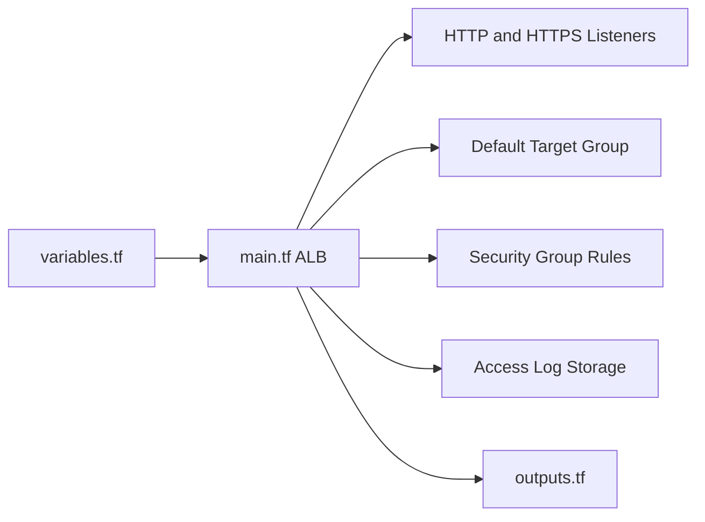

# cloudposse/terraform-aws-alb

> Module Terraform créant un ALB AWS, ses listeners, sa cible par défaut et ses groupes de sécurité.

## Le problème
Un ALB exige listeners HTTP/HTTPS, redirections, groupes de sécurité et bucket de logs, à reconfigurer à chaque projet.

## Ce que ça fait vraiment
Provisionne `aws_lb`, listeners HTTP, HTTPS et redirection, un groupe cible par défaut, les règles de groupe de sécurité et, en option, un bucket S3 d'access logs (module `lb-s3-bucket`). Expose ARN, DNS, ID de groupe de sécurité en sortie.

## Comment c'est branché


## Essayer
```hcl
module "alb" {
  source     = "cloudposse/alb/aws"
  vpc_id     = module.vpc.vpc_id
  subnet_ids = module.subnets.public_subnet_ids
  https_enabled = false
}
```
Tests : `atmos test run`.

## Coût et pièges
Facture AWS de l'ALB et du bucket de logs. Terraform >= 1.3, aws >= 5.99. `access_logs_enabled` vaut `true` par défaut, donc un bucket est créé.

## Ce que ce n'est pas
Pas un service applicatif : il ne crée pas ECS ni les cibles. Le dernier push date de mars 2026.

## Alternatives
terraform-aws-alb-ingress (règles d'ingress par hôte et chemin, même éditeur).

## Pour toi
Surveiller : brique classique pour exposer un service d'inférence derrière un ALB, à utiliser seulement si tu es déjà sur Terraform et AWS.

