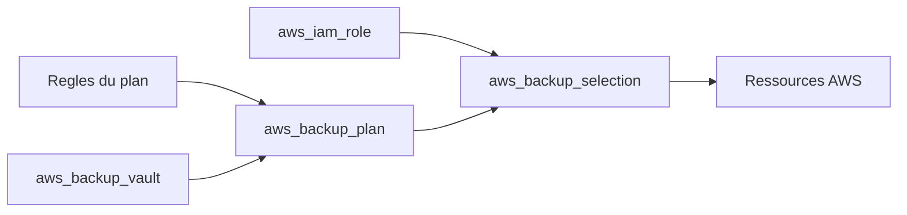

# cloudposse/terraform-aws-backup

> Terraform module that creates the vault, plan, rules and IAM role of AWS Backup.

## The problem
Backups of EBS, RDS, DynamoDB or EFS are often configured by hand, without consistent rules.

## What it actually does
Creates a vault (`aws_backup_vault`), a backup plan with rules (cron, windows, retention, cold storage archiving, copy to another vault), a resource selection by ARN or tags, an IAM role and an optional vault lock. The example backs up an EFS file system.

## How it is wired
Simplified diagram based on the sheet, no diagram provided.



## Trying it
```bash
atmos test run
atmos test clean
```
These are the README's test commands; normal usage is the `module "backup"` block to copy.

## Cost and gotchas
AWS account required; backup storage is billed by AWS. Schedule syntax changed in 0.14.0, deprecated variables removed in 1.x.

## What it is not
Not a restore or backup-testing tool. It describes AWS resources, it does not back anything up itself.

## Alternatives
- terraform-aws-efs-backup: EFS backup to S3 via DataPipeline.

## For you
Adopt if your datasets and databases live on AWS: protection becomes code, with explicit retention and lock.
