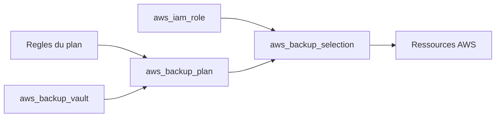

# cloudposse/terraform-aws-backup

> Module Terraform qui crée vault, plan, règles et rôle IAM d'AWS Backup.

## Le problème
Les sauvegardes d'EBS, RDS, DynamoDB ou EFS sont souvent configurées à la main, sans règles homogènes.

## Ce que ça fait vraiment
Crée un coffre (`aws_backup_vault`), un plan de sauvegarde avec règles (cron, fenêtres, conservation, archivage à froid, copie vers un autre coffre), une sélection de ressources par ARN ou balises, un rôle IAM et un verrou de coffre optionnel. L'exemple sauvegarde un système de fichiers EFS.

## Comment c'est branché
Schéma simplifié d'après la fiche, sans diagramme fourni.



## Essayer
```bash
atmos test run
atmos test clean
```
Ce sont les commandes de test du README ; l'usage normal est le bloc `module "backup"` à copier.

## Coût et pièges
Compte AWS requis ; le stockage de sauvegarde est facturé par AWS. Syntaxe des plannings changée à la 0.14.0, variables dépréciées supprimées en 1.x.

## Ce que ce n'est pas
Pas un outil de restauration ni de test de sauvegarde. Il décrit des ressources AWS, il ne sauvegarde rien lui-même.

## Alternatives
- terraform-aws-efs-backup : sauvegarde EFS vers S3 via DataPipeline.

## Pour toi
Adopter si tes jeux de données et bases vivent sur AWS : la protection devient du code, avec rétention et verrou explicites.

