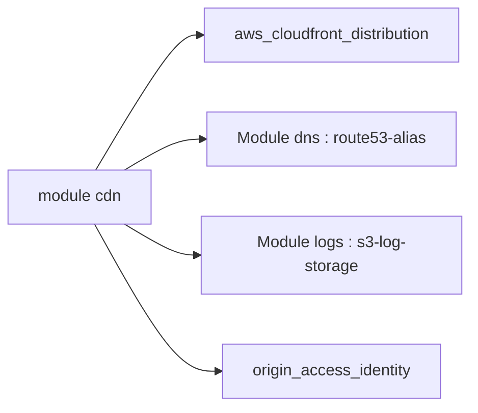

# cloudposse/terraform-aws-cloudfront-cdn

> Terraform module for a CloudFront distribution in front of a custom origin, with logs to S3.

## The problem
Configuring CloudFront, Route 53 DNS and log storage by hand is slow and repetitive.

## What it actually does
Creates a CloudFront distribution for a custom origin (website), an alias DNS record and a log bucket with expiration and transition to Glacier. Handles cache behaviors, headers, WAF, Lambda@Edge, mTLS and VPC origins. Names follow Cloud Posse's `null-label` convention.

## How it is wired
Simplified diagram based on the sheet, no diagram provided.


## Trying it
```hcl
module "cdn" {
  source = "cloudposse/cloudfront-cdn/aws"
  namespace          = "eg"
  stage              = "prod"
  name               = "app"
  aliases            = ["www.example.net"]
  origin_domain_name = "origin.example.com"
  parent_zone_name   = "example.net"
}
```

## Cost and gotchas
AWS account, Terraform 1.2+, AWS provider 6.28+. CloudFront, S3 and Route 53 are billed. An ACM certificate must be requested separately. For an S3 bucket, the author points to `terraform-aws-cloudfront-s3-cdn`.

## What it is not
Not meant to accelerate an S3 bucket: another module exists for that. The README is auto-generated and very long.

## Alternatives
- cloudposse/terraform-aws-cloudfront-s3-cdn: for an S3 bucket as origin.

## For you
Ignore: web CDN building block with no direct link to data / AI / MLOps work, except to serve a static interface.
