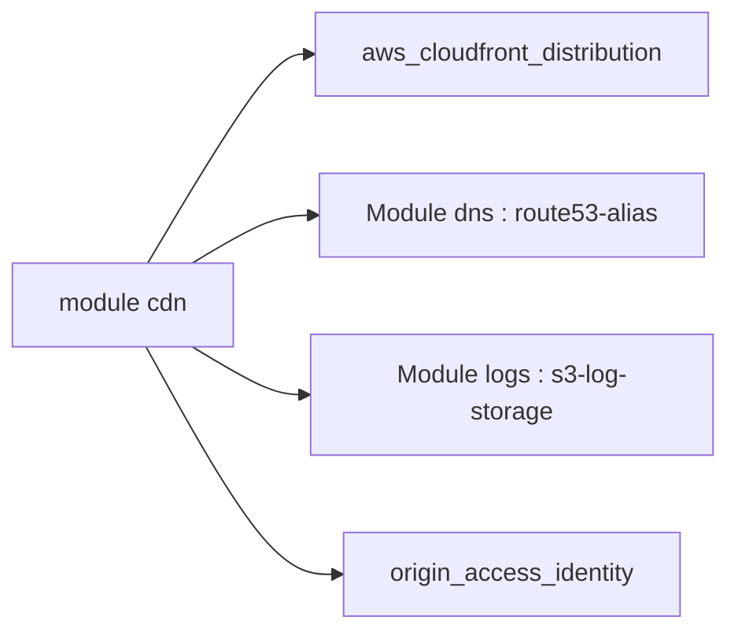

# cloudposse/terraform-aws-cloudfront-cdn

> Module Terraform pour une distribution CloudFront devant une origine personnalisée, avec logs vers S3.

## Le problème
Configurer CloudFront, DNS Route 53 et stockage de logs à la main est long et répétitif.

## Ce que ça fait vraiment
Crée une distribution CloudFront pour une origine personnalisée (site web), un enregistrement DNS d'alias et un bucket de logs avec expiration et passage en Glacier. Gère comportements de cache, en-têtes, WAF, Lambda@Edge, mTLS et origines VPC. Les noms suivent la convention `null-label` de Cloud Posse.

## Comment c'est branché
Schéma simplifié d'après la fiche, sans diagramme fourni.


## Essayer
```hcl
module "cdn" {
  source = "cloudposse/cloudfront-cdn/aws"
  namespace          = "eg"
  stage              = "prod"
  name               = "app"
  aliases            = ["www.example.net"]
  origin_domain_name = "origin.example.com"
  parent_zone_name   = "example.net"
}
```

## Coût et pièges
Compte AWS, Terraform 1.2+, provider AWS 6.28+. CloudFront, S3 et Route 53 sont facturés. Un certificat ACM est à demander à part. Pour un bucket S3, l'auteur renvoie à `terraform-aws-cloudfront-s3-cdn`.

## Ce que ce n'est pas
Pas fait pour accélérer un bucket S3 : un autre module existe. Le README est généré automatiquement et très long.

## Alternatives
- cloudposse/terraform-aws-cloudfront-s3-cdn : pour un bucket S3 en origine.

## Pour toi
Ignorer : brique CDN web sans lien direct avec un travail data / IA / MLOps, sauf pour servir une interface statique.

