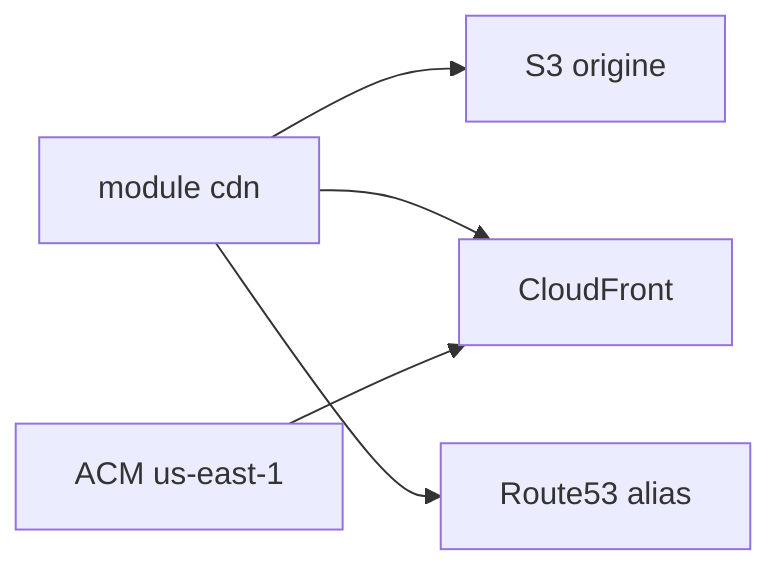

# cloudposse/terraform-aws-cloudfront-s3-cdn

> Terraform module that provisions a CloudFront CDN in front of an S3 bucket, for AWS teams.

## The problem
Assembling CloudFront, S3, ACM, DNS and origin access by hand is slow and error-prone.

## What it actually does
Creates the distribution, the origin bucket (or reuses an existing one), OAI/OAC access, logs, the Route53 alias and failover origins/groups. Handles website mode or private bucket (`website_enabled`) and Lambda@Edge via a submodule. The ACM certificate must be in us-east-1.

## How it is wired


## Trying it
```bash
module "cdn" { source = "cloudposse/cloudfront-s3-cdn/aws" }
TF_WARN_OUTPUT_ERRORS=1 terraform destroy
```

## Cost and gotchas
AWS bill is on you (CloudFront, S3, logs). Many variable names and defaults; pin the module version.

## What it is not
Not a host: it lays down the AWS infrastructure, not the content.

## Alternatives
terraform-aws-cloudfront-cdn (custom origin), cited in the README.

## For you
Worth watching: useful for serving assets or a model front end on AWS; otherwise of no interest.
