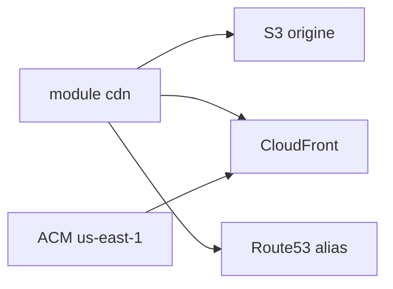

# cloudposse/terraform-aws-cloudfront-s3-cdn

> Module Terraform qui provisionne un CDN CloudFront devant un bucket S3, pour équipes AWS.

## Le problème
Assembler CloudFront, S3, ACM, DNS et accès à l'origine à la main est long et source d'erreurs.

## Ce que ça fait vraiment
Crée la distribution, le bucket d'origine (ou réutilise un existant), l'accès OAI/OAC, les logs, l'alias Route53 et des origines/groupes de failover. Gère le mode site web ou bucket privé (`website_enabled`) et Lambda@Edge via un sous-module. Le certificat ACM doit être en us-east-1.

## Comment c'est branché


## Essayer
```bash
module "cdn" { source = "cloudposse/cloudfront-s3-cdn/aws" }
TF_WARN_OUTPUT_ERRORS=1 terraform destroy
```

## Coût et pièges
Facture AWS à ta charge (CloudFront, S3, logs). Les noms et valeurs par défaut de variables sont nombreux ; épingler la version du module.

## Ce que ce n'est pas
Pas un hébergeur : il pose l'infra AWS, pas le contenu.

## Alternatives
terraform-aws-cloudfront-cdn (origine personnalisée), cité dans le README.

## Pour toi
À surveiller : utile pour servir des assets ou un front de modèle sur AWS ; sinon sans intérêt.

