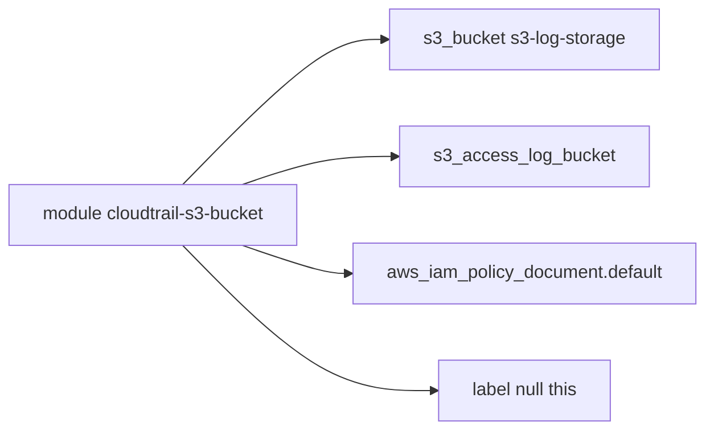

# cloudposse/terraform-aws-cloudtrail-s3-bucket

> Terraform module that creates an S3 bucket ready to receive CloudTrail logs, for AWS audit teams.

## The problem
Storing the CloudTrail logs of a production account in a separate audit account requires a bucket with the right policy and restricted access.

## What it actually does
Creates an S3 bucket with a policy for CloudTrail, enforced encryption, versioning, protection against deletion of a non-empty bucket and object lock (WORM) for compliance. It builds on Cloud Posse's `s3-log-storage` and `label` modules, with lifecycle rules and an optional access log bucket.

## How it is wired


## Trying it
```hcl
module "s3_bucket" {
  source = "cloudposse/cloudtrail-s3-bucket/aws"
  namespace = "eg"
  stage     = "prod"
  name      = "cluster"
}
```
```sh
atmos test run
```

## Cost and gotchas
AWS account required; storage, lifecycle and Glacier are billed. Object lock can only be enabled when the bucket is created. Tests require Atmos and Go 1.24+.

## What it is not
It is not a module that creates the CloudTrail itself: for that, the README points to `terraform-aws-cloudtrail`. Its examples are not pinned to a version: pin it yourself.

## Alternatives
- terraform-aws-cloudtrail: also creates the CloudTrail and its encrypted bucket.
- terraform-aws-s3-log-storage: generic bucket for AWS logs.

## For you
Worth watching: a clean building block if your AWS audit logs go through Terraform, but with no direct reach for AI models.
