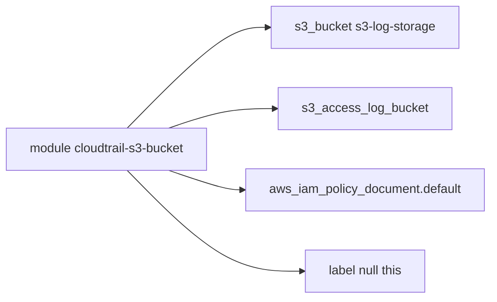

# cloudposse/terraform-aws-cloudtrail-s3-bucket

> Module Terraform qui crée un bucket S3 prêt à recevoir des journaux CloudTrail, pour équipes d'audit AWS.

## Le problème
Stocker les journaux CloudTrail d'un compte de production dans un compte d'audit séparé demande un bucket avec la bonne politique et un accès restreint.

## Ce que ça fait vraiment
Crée un bucket S3 avec politique pour CloudTrail, chiffrement forcé, versioning, protection contre la suppression d'un bucket non vide et verrouillage d'objets (WORM) pour la conformité. Il s'appuie sur les modules `s3-log-storage` et `label` de Cloud Posse, avec règles de cycle de vie et bucket de journaux d'accès optionnel.

## Comment c'est branché


## Essayer
```hcl
module "s3_bucket" {
  source = "cloudposse/cloudtrail-s3-bucket/aws"
  namespace = "eg"
  stage     = "prod"
  name      = "cluster"
}
```
```sh
atmos test run
```

## Coût et pièges
Compte AWS requis ; le stockage, le cycle de vie et Glacier sont facturés. Le verrouillage d'objets ne s'active qu'à la création du bucket. Les tests exigent Atmos et Go 1.24+.

## Ce que ce n'est pas
Ce n'est pas un module qui crée le CloudTrail lui-même : pour cela, le README renvoie à `terraform-aws-cloudtrail`. Il épingle ses exemples sans version : à fixer chez toi.

## Alternatives
- terraform-aws-cloudtrail : crée aussi le CloudTrail et son bucket chiffré.
- terraform-aws-s3-log-storage : bucket générique pour journaux AWS.

## Pour toi
À surveiller : brique propre si tes journaux d'audit AWS passent par Terraform, mais sans portée directe pour des modèles d'IA.

