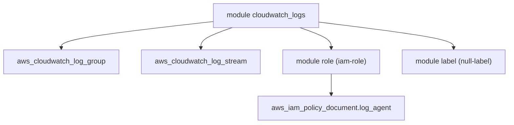

# cloudposse/terraform-aws-cloudwatch-logs

> Cloud Posse Terraform module that creates CloudWatch Logs groups and streams on AWS.

## The problem
Creating log groups, their streams and the write IAM role by hand is repetitive.

## What it actually does
The module creates a log group, named streams (stream_names) and, by default, an IAM role allowed to write to the group. It handles retention (30 days by default) and optional KMS encryption. The README presents it as useful with Fluentd or Fluent-bit.

## How it is wired


## Trying it
```bash
atmos test run
atmos test clean
```

## Cost and gotchas
An AWS account is required and log storage is billed by AWS. The README recommends pinning the module version. Tests require Atmos, Go 1.24+ and Terraform or OpenTofu.

## What it is not
It is not a collection tool: it does not ship logs, it only prepares the destination. The README mixes in a lot of advertising for Cloud Posse's commercial offering.

## Alternatives
- terraform-aws-cloudwatch-flow-logs: for VPC and subnet flow logs.

## For you
Worth watching: a standard building block if your AWS infrastructure is already in Terraform, useless otherwise.
