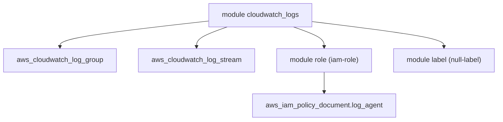

# cloudposse/terraform-aws-cloudwatch-logs

> Module Terraform de Cloud Posse qui crée groupes et flux CloudWatch Logs sur AWS.

## Le problème
Créer proprement des groupes de logs, leurs flux et le rôle IAM d'écriture à la main est répétitif.

## Ce que ça fait vraiment
Le module crée un groupe de logs, des flux nommés (stream_names) et, par défaut, un rôle IAM autorisé à écrire dans le groupe. Il gère la rétention (30 jours par défaut) et un chiffrement KMS optionnel. Le README le présente comme utile avec Fluentd ou Fluent-bit.

## Comment c'est branché


## Essayer
```bash
atmos test run
atmos test clean
```

## Coût et pièges
Un compte AWS est nécessaire et le stockage de logs est facturé par AWS. Le README recommande de figer la version du module. Les tests demandent Atmos, Go 1.24+ et Terraform ou OpenTofu.

## Ce que ce n'est pas
Ce n'est pas un outil de collecte : il ne ship pas les logs, il prépare seulement la destination. Le README mêle beaucoup de publicité pour l'offre commerciale de Cloud Posse.

## Alternatives
- terraform-aws-cloudwatch-flow-logs : pour les flow logs de VPC et de sous-réseaux.

## Pour toi
À surveiller : brique standard si ton infra AWS est déjà en Terraform, inutile sinon.

