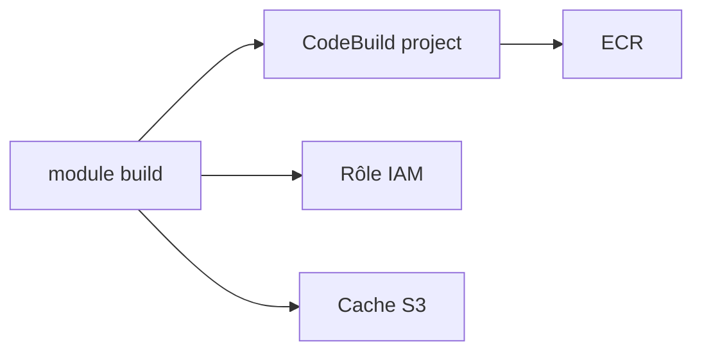

# cloudposse/terraform-aws-codebuild

> Terraform module that creates an AWS CodeBuild project for CodePipeline, with an IAM role and S3 cache.

## The problem
A usable CodeBuild project needs an IAM role, a cache, environment variables and source credentials.

## What it actually does
Creates the CodeBuild project, the IAM role and policies, an optional S3 cache bucket, the GitHub/Bitbucket credentials, and passes the variables useful for building Docker images to ECR. By default the source is CODEPIPELINE.

## How it is wired


## Trying it
```bash
module "build" { source = "cloudposse/codebuild/aws" }
```
With `build_image`, `build_compute_type`, `privileged_mode`.

## Cost and gotchas
AWS build minutes at your expense. `privileged_mode` is required to build Docker images. GitHub token stored according to the chosen type.

## What it is not
Not a generic CI orchestrator: tied to AWS CodeBuild.

## Alternatives
terraform-aws-ecs-codepipeline, cited in the README.

## For you
Watch: only if your CI is on AWS CodeBuild; otherwise GitHub Actions is enough.
