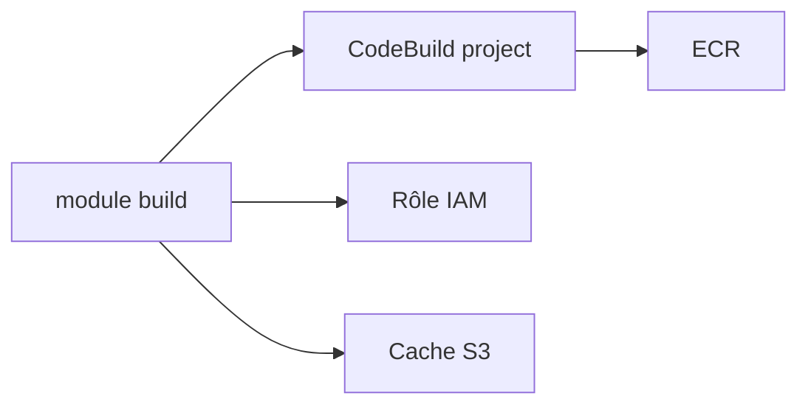

# cloudposse/terraform-aws-codebuild

> Module Terraform qui crée un projet AWS CodeBuild pour CodePipeline, avec rôle IAM et cache S3.

## Le problème
Un projet CodeBuild utilisable demande rôle IAM, cache, variables d'environnement et credentials source.

## Ce que ça fait vraiment
Crée le projet CodeBuild, le rôle et politiques IAM, un bucket de cache S3 optionnel, les credentials GitHub/Bitbucket, et passe les variables utiles au build d'images Docker vers ECR. Par défaut la source est CODEPIPELINE.

## Comment c'est branché


## Essayer
```bash
module "build" { source = "cloudposse/codebuild/aws" }
```
Avec `build_image`, `build_compute_type`, `privileged_mode`.

## Coût et pièges
Minutes de build AWS à ta charge. `privileged_mode` requis pour construire des images Docker. Jeton GitHub stocké selon le type choisi.

## Ce que ce n'est pas
Pas un orchestrateur CI générique : lié à AWS CodeBuild.

## Alternatives
terraform-aws-ecs-codepipeline, cité dans le README.

## Pour toi
À surveiller : seulement si ta CI est sur AWS CodeBuild ; sinon GitHub Actions suffit.

