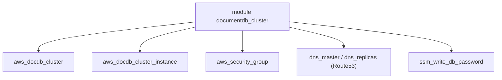

# cloudposse/terraform-aws-documentdb-cluster

> Cloud Posse Terraform module to create an Amazon DocumentDB cluster, for teams that manage AWS as code.

## The problem
Setting up a DocumentDB cluster with its subnets, security groups, DNS and passwords requires assembling a lot of resources.

## What it actually does
The module creates the cluster, its instances, the parameter group, the subnet group and the security group. It generates a random password, can store it in SSM and create Route53 CNAMEs for writing and reading. A serverless v2 configuration is possible.

## How it is wired


## Trying it
```bash
atmos test run
atmos test clean
```

## Cost and gotchas
An AWS account is required and the cluster is billed (three db.r4.large instances by default). The master password ends up in the Terraform state and may appear in logs. Deletion protection is disabled by default.

## What it is not
It is not a backup or migration module: it only provisions the cluster. The defaults (engine 3.6.0, family docdb3.6) are old.

## Alternatives
- terraform-aws-rds: for MySQL or Postgres.
- terraform-aws-rds-cluster: for an Aurora MySQL or Postgres cluster.

## For you
Worth watching: useful if you need to deploy DocumentDB with Terraform, but check the default versions before use.
