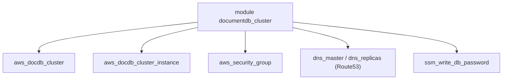

# cloudposse/terraform-aws-documentdb-cluster

> Module Terraform de Cloud Posse pour créer un cluster Amazon DocumentDB, pour équipes qui gèrent AWS en code.

## Le problème
Monter un cluster DocumentDB avec ses sous-réseaux, groupes de sécurité, DNS et mots de passe demande beaucoup de ressources à assembler.

## Ce que ça fait vraiment
Le module crée le cluster, ses instances, le groupe de paramètres, le groupe de sous-réseaux et le groupe de sécurité. Il génère un mot de passe aléatoire, peut le stocker dans SSM et créer des CNAME Route53 pour l'écriture et la lecture. Une configuration serverless v2 est possible.

## Comment c'est branché


## Essayer
```bash
atmos test run
atmos test clean
```

## Coût et pièges
Un compte AWS est nécessaire et le cluster est facturé (trois instances db.r4.large par défaut). Le mot de passe maître finit dans l'état Terraform et peut apparaître dans les logs. La protection contre la suppression est désactivée par défaut.

## Ce que ce n'est pas
Ce n'est pas un module de sauvegarde ni de migration : il provisionne seulement le cluster. Les valeurs par défaut (engine 3.6.0, famille docdb3.6) sont anciennes.

## Alternatives
- terraform-aws-rds : pour MySQL ou Postgres.
- terraform-aws-rds-cluster : pour un cluster Aurora MySQL ou Postgres.

## Pour toi
À surveiller : utile si tu dois déployer DocumentDB en Terraform, mais vérifie les versions par défaut avant usage.

