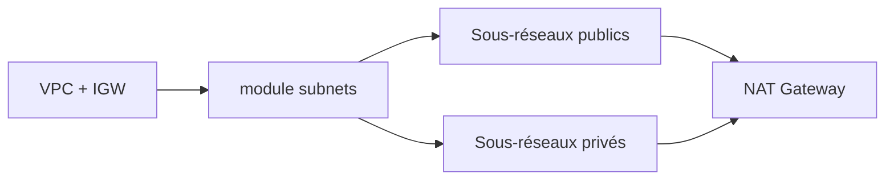

# cloudposse/terraform-aws-dynamic-subnets

> Terraform module that creates public and private subnets in an existing AWS VPC.

## The problem
Splitting a CIDR into per-zone subnets, with routes, NAT and ACLs, is repetitive and fragile.

## What it actually does
Divides the CIDR (IPv4, IPv6 /56), creates public and private subnets per AZ, route tables, NAT Gateway or instance, open ACLs. The number and names of subnets are configurable per type; `max_nats` limits cost; named outputs include NAT IDs.

## How it is wired


## Trying it
```bash
module "subnets" { source = "cloudposse/dynamic-subnets/aws" }
```
Variables: `vpc_id`, `igw_id`, `ipv4_cidr_block`, `availability_zones`.

## Cost and gotchas
AWS bill: each NAT Gateway costs about $32/month according to the README. Keep the AZ order stable, otherwise resources are recreated.

## What it is not
Does not create the VPC or the Internet Gateway.

## Alternatives
terraform-aws-vpc, cited in the README, to create the VPC.

## For you
Worth watching: a useful networking building block for hosting ML workloads on AWS, otherwise off-topic.
