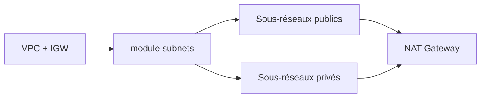

# cloudposse/terraform-aws-dynamic-subnets

> Module Terraform qui crée des sous-réseaux publics et privés dans un VPC AWS existant.

## Le problème
Découper un CIDR en sous-réseaux par zone, avec routes, NAT et ACL, est répétitif et fragile.

## Ce que ça fait vraiment
Divise le CIDR (IPv4, IPv6 /56), crée sous-réseaux publics et privés par AZ, tables de routage, NAT Gateway ou instance, ACL ouvertes. Nombre et noms de sous-réseaux configurables par type ; `max_nats` limite le coût ; sorties nommées avec IDs de NAT.

## Comment c'est branché


## Essayer
```bash
module "subnets" { source = "cloudposse/dynamic-subnets/aws" }
```
Variables : `vpc_id`, `igw_id`, `ipv4_cidr_block`, `availability_zones`.

## Coût et pièges
Facture AWS : chaque NAT Gateway coûte environ 32 $/mois selon le README. Ordre des AZ à garder stable, sinon recréation.

## Ce que ce n'est pas
Ne crée pas le VPC ni l'Internet Gateway.

## Alternatives
terraform-aws-vpc, cité dans le README, pour créer le VPC.

## Pour toi
À surveiller : brique réseau utile pour héberger des workloads ML sur AWS, sinon hors sujet.

